# 은퇴 포트폴리오 정량 분석: VT · 금(GLDM) · 미국 국채(VGIT/SGOV)

> 대상: 34세, Traditional IRA(Robinhood) $80,000, 추가 납입 없음, 투자기간 30년(2026→2055/56).
> 모든 수치는 이 저장소의 코드(`src/`)를 **실제로 실행한 결과**입니다(실행일 2026-11-06, 실행 로그 `output/run_log.txt`).
> 1972–2008 구간은 **프록시로 합성한 수익률(simulated)**이며 투자 가능한 ETF 수익률이 아닙니다. 구간별 출처는 §1에 있습니다.

---

## 0. Executive Summary (핵심 결론)

1. **A안 VT90/금10은 이미 "성장" 기준으로는 효율적입니다.** 1972–2025 CAGR 9.6%로 원래 세 안 중 최고이고, 모든 기간에서 VT100과 같거나 더 높은 수익률을 더 낮은 변동성으로 냈습니다(예외: 1980–2024, 2009–2024).
   다만 금의 효과는 **1970년대와 2000년대 금 강세장**에 크게 의존합니다. 1980–2024 구간에서는 A − VT100의 Sharpe 차이가 −0.002로 사실상 0입니다.
2. **국채를 넣으면 위험조정 성과는 개선되지만 수익률은 늘지 않습니다.** B(VGIT 10%) − A의 차이는 Sharpe +0.018(block-bootstrap P>0 = 99%), CAGR −0.20pp/년(P>0 = 19%)입니다.
   국채의 실제 가치는 **꼬리위험 축소**입니다. MDD가 −48%에서 −42%로 줄고, Monte Carlo의 P(MDD>40%)는 방법론에 따라 42–66%에서 27–49%로 내려갑니다.
3. **VGIT가 SGOV보다 낫습니다.** 1972–2025와 1980–2024에서 B − C의 CAGR 차이는 +0.19~0.24pp/년(P>0 ≥ 96%)입니다. 국면별로 나누면 VGIT는 디플레이션 침체·금융위기에서, SGOV는 인플레이션 쇼크·금리 상승기에서 이깁니다.
   금이 이미 인플레이션 쪽 헤지를 맡고 있으므로 **금과 상호보완적인 자산은 VGIT**입니다. 4-ETF 조합(VGIT5+SGOV5)은 개선이 없어 기각했습니다.
4. **in-sample 최적화는 과적합 신호를 보입니다.** 최적해가 VT 60%(하한)와 금 30%(상한)라는 경계로 몰립니다. walk-forward(1990–2025 OOS)로 검증하면 매년 재최적화한 규칙의 CAGR(7.35–7.83%)이 **고정 A안(8.14%)·B안(7.94%)보다 낮습니다.**
5. **리밸런싱의 수익 프리미엄은 통계적으로 신뢰하기 어렵습니다.** 1972–2025 실적에서는 +30~70bp/년이었지만, 30년 block-bootstrap에서는 평균 −12~−34bp, 중앙값 −1~+15bp, P(>0)는 43–65%에 그쳤습니다.
   역사적 이득의 상당 부분은 1980년 금 고점에서 금을 판 효과입니다. 리밸런싱은 **수익원이 아니라 위험 통제 수단**으로 봐야 합니다. 정책으로는 "연 1회 점검 + 5pp 밴드"가 가장 효율적이었습니다(1972–2025, 54년간 20–45회 거래).
6. **2025년(GLDM +64%)을 빼도 장기 최적 비중은 거의 변하지 않습니다.** 1972–2024 max-Sharpe는 VT60/G20/IT20으로, 2025를 넣은 VT60/G22/IT18과 비슷합니다.
   단기 구간(2009–, 2016–)에서는 결론이 달라집니다. 2009–2024 max-CAGR은 VT100이 됩니다.
7. **2026년 1–9월(완전한 out-of-sample, 모델 선택에 미사용)**: VT +12.9%, 금 −3.7%, VGIT −3.0%였습니다. VT100(+12.9%) > A(+11.2%) > B(+9.6%) 순으로, 금·채권 비중이 클수록 뒤처졌습니다. 한 해짜리 관측이므로 증거력은 낮습니다.

**최종 권고 3안 (상세는 §11)**

| 목적 | 비중 | $80,000 배분 | 리밸런싱 |
|---|---|---|---|
| 최대 성장 | **VT 90 / GLDM 10** | VT $72,000 · GLDM $8,000 | 연 1회 점검, 5pp 밴드 |
| 최대 위험조정 | **VT 70 / GLDM 15 / VGIT 15** | VT $56,000 · GLDM $12,000 · VGIT $12,000 | 연 1회 점검, 5pp 밴드 |
| **Robust Set-and-Forget (주 권고)** | **VT 75 / GLDM 15 / VGIT 10** | VT $60,000 · GLDM $12,000 · VGIT $8,000 | 연 1회 점검, 5pp 밴드 |

---

## 1. 데이터, 방법론, 가정

### 1.1 월간 총수익률 패널 (1972-01 ~ 2025-12, 648개월, USD)

| 자산 | 구간 | 출처 / 구성 | 비용 처리 |
|---|---|---|---|
| **VT** | 1972-01~1990-06 | Ken French Data Library 미국 시장 전체(Mkt-RF+RF, 배당 포함) | −0.06%/년(VT ER) |
| | 1990-07~2008-07 | Ken French **Developed** market(Mkt-RF+RF, USD, 배당 포함) | −0.06%/년 |
| | 2008-08~ | **VT ETF** Yahoo adjusted close(분배금 재투자) | ETF 가격에 내재 |
| **금** | 1972-01~2004-12 | 월간 금 가격(datahub.io `gold-prices` = **월평균 가격**) → 평균화 편향 보정(아래) | −0.10%/년(GLDM ER) |
| | 2005-01~2018-07 | **GLD ETF** adj. close, ER 차이(0.40→0.10%) 가산 | |
| | 2018-08~ | **GLDM ETF** | 내재 |
| **VGIT** | 1972-01~2007-02 | 5년 CMT(Yahoo ^FVX) 기반 **par-bond 재평가 모델**(Damodaran과 동일 방식, 만기 5년) | −0.03%/년 |
| | 2007-03~2009-12 | **IEI ETF**(3–7y Treasury), ER 차이 가산 | |
| | 2010-01~ | **VGIT ETF** | 내재 |
| **T-bill** | 1972-01~2007-06 | Ken French RF(1개월 T-bill) | −0.09%/년(SGOV ER) |
| | 2007-07~2020-06 | **BIL ETF**, ER 차이 가산 | |
| | 2020-07~ | **SGOV ETF** | 내재 |
| CPI | 전 구간 | BLS CPI-U NSA(datahub.io `cpi-us` 미러). 2025-10은 정부 셧다운으로 미발표라 로그선형 보간 | — |
| Sharpe 무위험수익률 | 전 구간 | French RF(gross 1M T-bill) | — |

**프록시 검증(overlap 구간)**: `output/tables/proxy_validation.csv`

| 검증 | 기간 | 상관 | 연 tracking error | CAGR 차이 |
|---|---|---|---|---|
| VT vs French Developed | 2008-08~2026-09 | 0.992 | 2.1% | Developed가 +0.30%/년(EM·소형주 차이) |
| VGIT vs 5y par-bond 모델 | 2010-01~2026-11 | 0.986 | 0.78% | 모델이 −0.58%/년 → **1972–2007 VGIT 프록시는 보수적** |
| SGOV vs French RF | 2020-07~2026-09 | 0.992 | 0.08% | −0.06%/년 |
| 금 연간수익률 vs Damodaran(연말가) | 1972–2024 | 0.988 | — | — |

### 1.2 명시적 가정과 한계 (중요)

1. **금 1972–2004 월평균 편향**: 월평균 가격으로 계산한 수익률은 변동성이 약 √(2/3)로 줄고 AR(1)≈0.25가 생깁니다(Working, 1960). 실측으로도 GLD 대비 변동성 비율이 0.78이었습니다.
   그래서 **로그수익률 공간에서 ρ=0.25 Geltner 역필터**로 보정했고, 누적수익률은 보존됩니다(보정 전후 1972–2004 CAGR 7.21% vs 7.22%). 변동성은 19.3%에서 24.7%로, MDD는 −62.8%에서 −67.6%로 커졌습니다.
   보정은 모델 기반이며 정확한 월말가를 복원하지 못합니다.
2. **1975년 이전 미국 개인의 금 보유는 불법**이었습니다. 1972–74 금 수익률(1973–74 +186%)은 미국 투자자에게 투자 불가능한 수익입니다. 금 비중을 지지하는 결론은 반드시 1980–2024 구간에서 교차 확인했습니다.
3. **VT 프록시의 구성 차이**: 1972–1990은 미국만, 1990–2008은 선진국만(EM 제외)입니다. VT의 EM·소형주 노출은 2008년 이후에만 반영됩니다. 1972–1990의 미국 단독 프록시는 같은 기간 일본 강세를 빠뜨리므로 글로벌 수익률과 차이가 납니다.
4. **월말 데이터**: MDD·회복기간은 월말 기준이라 일중·월중 낙폭(예: 2020-03 장중 저점)을 과소평가합니다.
5. **거래비용**: 거래대금의 편도 5bp(스프레드+슬리피지)를 가정했습니다. Robinhood는 수수료가 없고 VT/GLDM/VGIT 스프레드는 대체로 1–3bp라 보수적인 값입니다.
6. **세금**: Traditional IRA 내부 거래는 과세 이벤트가 아니므로 리밸런싱 세금은 0으로 두었습니다. 보고된 모든 금액은 **세전(pre-tax)**입니다.
   인출은 일반소득세 대상이고 RMD가 있습니다(1960년 이후 출생자는 SECURE 2.0에 따라 75세부터).
7. **Look-ahead 방지**: 리밸런싱 결정은 그 달 수익이 실현된 뒤 월말 정보만 씁니다. walk-forward는 매년 1월에 직전 12월까지의 데이터로만 비중을 고릅니다. 2026년 데이터는 어떤 선택에도 쓰지 않았습니다.
8. **생존편향**: 시장 전체 지수, 국채, 금만 쓰므로 개별 종목이나 펀드 생존편향은 없습니다. 다만 "미국 주식이 지난 50년간 승자였다"는 **국가 수준 생존편향**은 남아 있습니다(VT 프록시의 1972–1990 구간).
9. **지표 정의**: Sharpe와 Sortino는 월 초과수익(over 1M T-bill) 기준으로 연율화했습니다. CVaR95는 월수익률 하위 5% 평균입니다. Worst 12m은 누적, Worst 36m은 연율화 값입니다. 실질 자산은 CPI-U로 디플레이트했습니다.
10. 기본 리밸런싱은 **연 1회(12월 말)**이며, 별도 표기가 없는 모든 백테스트에 적용됩니다.

---

## 2. 원래 세 포트폴리오 비교

### 2.1 1972–2025 (장기, 프록시 포함 · $80,000 시작 · 연 1회 리밸런싱)

| 지표 | VT100 | **A** VT90/G10 | **B** VT80/G10/VGIT10 | **C** VT80/G10/SGOV10 | VT80/VGIT20 |
|---|---|---|---|---|---|
| CAGR | 9.3% | **9.6%** | 9.4% | 9.2% | 8.9% |
| 변동성 | 15.8% | 14.4% | 12.9% | **12.8%** | 12.7% |
| Max Drawdown | −53.9% | −48.3% | **−42.4%** | −43.4% | −42.5% |
| Sharpe | 0.369 | 0.414 | **0.432** | 0.420 | 0.398 |
| Sortino | 0.531 | 0.600 | **0.630** | 0.609 | 0.578 |
| Calmar | 0.172 | 0.200 | **0.223** | 0.213 | 0.209 |
| CVaR95(월) | −10.3% | −9.2% | −8.1% | −8.1% | −8.0% |
| 최악 12개월 | −47.2% | −42.9% | −37.8% | −38.4% | −37.0% |
| 최악 36개월(연율) | −17.3% | −15.0% | −12.3% | −12.9% | −11.9% |
| MDD 회복(저점→전고점, 개월) | 50 | 26 | 24 | 24 | 26 |
| 최장 수중기간(개월) | 65 | 56 | 55 | 55 | 55 |
| 최종가치(명목) | $9.58M | **$11.51M** | $10.42M | $9.50M | $8.01M |
| 최종가치(실질, 1972$) | $1.22M | **$1.46M** | $1.32M | $1.21M | $1.02M |

### 2.2 2009–2025 (실제 ETF 시대: VT는 실제 ETF, 금은 GLD→GLDM, 채권은 IEI→VGIT, BIL→SGOV)

| 지표 | VT100 | A | B | C |
|---|---|---|---|---|
| CAGR | **11.3%** | **11.3%** | 10.5% | 10.4% |
| 변동성 | 15.6% | 14.3% | 12.7% | 12.7% |
| MDD | −25.5% | −23.9% | −22.5% | **−21.3%** |
| Sharpe / Sortino | 0.687 / 1.07 | 0.737 / 1.17 | **0.750 / 1.20** | 0.745 / 1.19 |
| Calmar | 0.443 | 0.473 | 0.465 | **0.487** |
| 최종가치 / 실질 | $494.6k / $320.9k | $494.1k / $320.5k | $433.6k / $281.3k | $427.8k / $277.6k |

### 2.3 구간별 CAGR (2025 포함 → 2025 제외)

| 구간 | VT100 | A | B | C |
|---|---|---|---|---|
| 1972–2025 / –2024 | 9.3 / 9.0 | **9.6 / 9.3** | 9.4 / 9.2 | 9.2 / 9.0 |
| 1980–2025 / –2024 | **9.9 / 9.7** | 9.6 / 9.3 | 9.4 / 9.0 | 9.1 / 8.8 |
| 2000–2025 / –2024 | 6.7 / 6.1 | **7.4 / 6.7** | 7.2 / 6.6 | 7.0 / 6.4 |
| 2009–2025 / –2024 | 11.3 / **10.7** | 11.3 / 10.4 | 10.5 / 9.6 | 10.4 / 9.5 |
| 2010–2019 | **9.0** | 8.6 | 8.1 | 7.8 |
| 2016–2025 / –2024 | 11.8 / 10.6 | **12.2 / 10.7** | 11.2 / 9.8 | 11.3 / 9.9 |
| 2020–2025 / –2024 | 11.9 / 10.0 | **12.8 / 10.2** | 11.7 / 9.2 | 11.9 / 9.5 |

전체 지표(14개 구간 × 6개 포트폴리오)는 `output/tables/window_backtests.csv`에 있습니다.

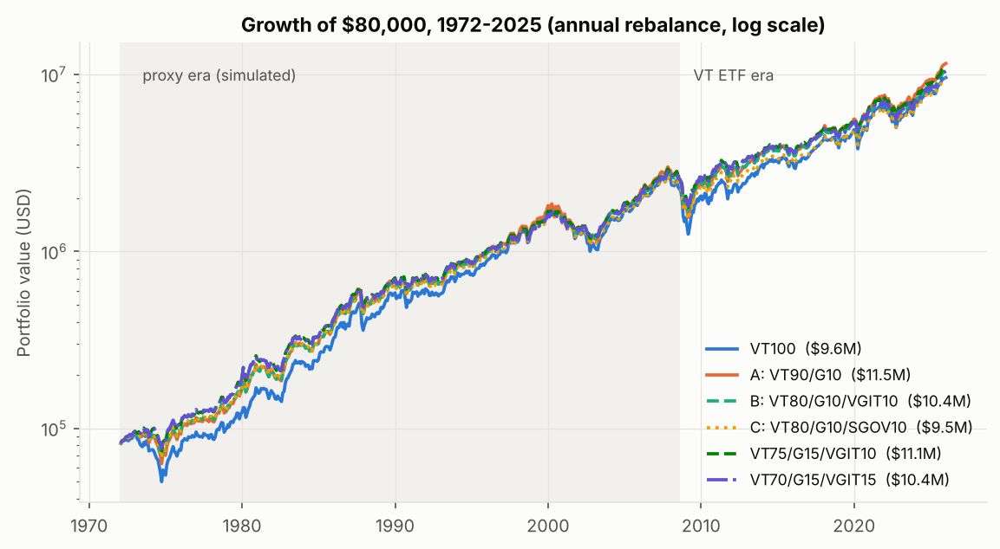
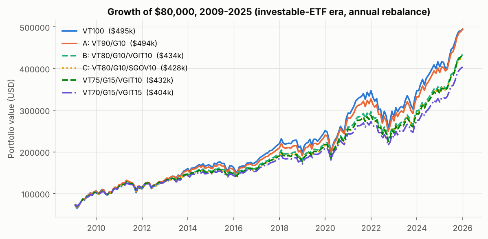
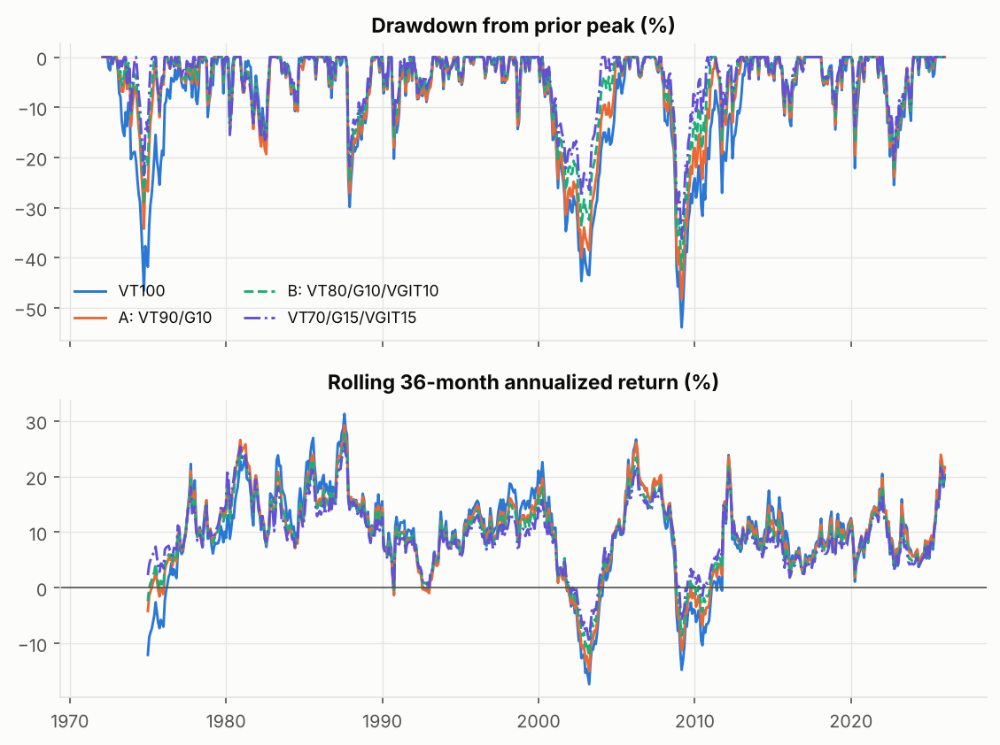

### 2.4 차이의 통계적 신뢰도 (stationary block bootstrap, 평균 블록 24개월, 2,000회)

| 비교 | 구간 | ΔSharpe [5%, 95%] | P(ΔSharpe>0) | ΔCAGR [5%, 95%] | P(ΔCAGR>0) |
|---|---|---|---|---|---|
| A − VT100 | 1972–2025 | +0.045 [−0.003, +0.095] | 94% | +0.37pp [−0.49, +1.28] | 74% |
| A − VT100 | 1980–2024 | −0.002 [−0.040, +0.032] | 44% | −0.39pp [−1.01, +0.26] | 17% |
| B − A | 1972–2025 | +0.018 [+0.005, +0.032] | 99% | −0.20pp [−0.60, +0.20] | 19% |
| C − A | 1972–2025 | +0.006 [−0.002, +0.014] | 90% | −0.39pp [−0.75, −0.03] | 4% |
| **B − C** | 1972–2025 | +0.012 [−0.000, +0.024] | 95% | **+0.19pp [+0.04, +0.34]** | **98%** |
| **B − C** | 1980–2024 | +0.016 [+0.002, +0.029] | 97% | **+0.24pp [+0.07, +0.40]** | **99%** |

P(>0)는 재표본 분포의 비율이며, 엄밀한 p-value가 아니라 표본 불확실성의 척도입니다.

---

## 3. 상관관계와 조건부 상관

**전 구간 월간 상관(1972–2025)**: VT–Gold 0.04, VT–VGIT 0.07, VT–T-bill −0.02, Gold–VGIT 0.06. 무조건부로 보면 거의 무상관입니다.
**하지만 국면에 따라 크게 바뀝니다.** `output/tables/conditional_correlations.csv`

| 조건 | N(월) | VT–Gold | VT–VGIT | Gold–VGIT | 평균 월수익 VT / 금 / VGIT / T-bill |
|---|---|---|---|---|---|
| VT 최악 10% 월 | 65 | 0.30 | **−0.29** | −0.06 | −7.96% / **+1.23%** / +0.55% / +0.37% |
| VT drawdown >20% | 90 | 0.14 | −0.28 | 0.21 | −1.04 / +0.61 / +0.58 / +0.22 |
| CPI YoY >5% | 150 | 0.04 | **+0.30** | 0.01 | +0.46 / **+1.19** / +0.52 / +0.59 |
| CPI YoY <2.5% | 210 | 0.02 | **−0.21** | 0.30 | +1.25 / +0.70 / +0.36 / +0.14 |
| 1972–1999 | 336 | −0.01 | +0.22 | −0.03 | |
| 2000–2020 | 252 | 0.12 | **−0.35** | 0.28 | |
| 2021–2025 | 60 | 0.25 | **+0.59** | 0.44 | |

**주식 폭락 월(VT 하위 10%)을 인플레이션 수준으로 나눈 결과**

| | N | VT | 금 | VGIT | 금 hit-rate | VGIT hit-rate |
|---|---|---|---|---|---|---|
| CPI YoY >4% | 28 | −8.3% | **+1.6%** | −0.2% | 54% | 50% |
| CPI YoY ≤4% | 37 | −7.7% | +0.9% | **+1.1%** | 59% | **68%** |

해석:
- **주식 낙폭을 막아준 자산**: 저인플레이션 붕괴(디플레이션 침체, 금융위기)에서는 VGIT, 고인플레이션 붕괴에서는 금이었습니다. T-bill은 언제나 소폭 플러스지만 헤지 규모가 작습니다.
- **인플레이션발 매도에서 헤지에 실패한 자산**: VGIT입니다. 고인플레이션 국면에서 VT–VGIT 상관이 +0.30이었고, 2021–2025에는 +0.59였습니다. 2022년에는 VGIT −11.8%, VT −12.7%로 함께 빠졌습니다.
- **분산 효과는 국면에 따라 변합니다.** 상관이 상수라는 가정은 기각됩니다(36개월 rolling VT–VGIT 상관 범위는 약 −0.6~+0.7).
- **금과 국채는 대체로 보완적입니다.** 조건부 상관이 낮고(−0.06~0.30) 서로 다른 국면에서 작동합니다. 다만 2021–2025에는 Gold–VGIT 상관이 0.44로 올라 중복성이 커졌습니다.

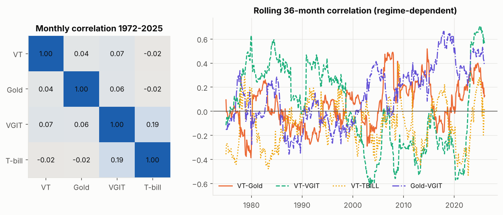

---

## 4. 거시 국면 분석 (실제 역사적 에피소드)

국면 날짜는 포트폴리오 성과가 아니라 NBER 경기순환, CPI, 금리 기준으로 사전에 정했습니다. 수익률은 연율 기하평균(%)이며, 여러 에피소드가 있는 국면은 해당 월들을 이어 붙여 계산했습니다.

| 국면 (에피소드) | VT100 | A | B | C | VT80/VGIT20 | VT75/G15/IT10 | VT70/G15/IT15 | 금 | VGIT | T-bill |
|---|---|---|---|---|---|---|---|---|---|---|
| 1 디플레이션 침체 (2000-09–02-09, 2020-02–03) | −29.8 | −26.0 | −21.6 | −22.7 | −21.1 | −19.7 | **−17.6** | 7.4 | **13.8** | 3.3 |
| 2 스태그플레이션 (1973–74, 1980–82.07) | −8.4 | −4.6 | −2.9 | −2.6 | −4.9 | −1.2 | **−0.4** | **17.3** | 7.0 | 10.4 |
| 3 인플레이션 쇼크 (1977–80.03, 2021.04–22.09) | 0.2 | 3.6 | 3.4 | 4.2 | −0.2 | **5.1** | 5.0 | **31.9** | −2.5 | 5.4 |
| 4 기술주 주도 강세 (1995–99, 2023–24) | **18.9** | 17.2 | 15.9 | 15.8 | 16.4 | 15.1 | 14.4 | 0.8 | 6.0 | 5.1 |
| 5 금 강세/주식 약세 (2001.01–2011.08) | 3.5 | 5.3 | 5.8 | 5.4 | 4.6 | 6.7 | **6.9** | **19.5** | 5.7 | 2.0 |
| 6 금리 상승 (1994, 2022.01–23.10) | −2.7 | −2.2 | −2.4 | **−1.5** | −3.3 | −2.2 | −2.3 | 2.0 | **−5.8** | 3.4 |
| 7 금융위기 (2007.11–09.02, 1987.09–11) | −51.0 | −45.4 | −39.8 | −40.5 | −39.9 | −36.9 | **−33.9** | 11.9 | 10.9 | 2.4 |
| 8 정상 확장 (1983–89, 2003.04–07.10, 2012–19) | **16.0** | 14.9 | 13.9 | 13.7 | 13.9 | 13.3 | 12.8 | 3.8 | 5.2 | 3.5 |

- 스태그플레이션과 인플레이션 쇼크 국면의 금 수익(1973–74, 1977–80)은 일부가 미국 개인에게 투자 불가능했던 시기의 수치입니다(§1.2-2).
- **VGIT vs SGOV**: SGOV(C)는 국면 3·6(인플레이션, 금리 상승)에서 이기고, VGIT(B)는 국면 1·5·7(디플레이션, 금융위기)에서 이깁니다. 같은 국면을 커버하는 금과 SGOV는 일부 **중복**되고, 금과 VGIT는 **보완**적입니다.
- **joint stock/bond selloff(2022)**에서 진짜 방어 자산은 T-bill과 (부분적으로) 금뿐이었습니다.

에피소드별 상세(누적수익, MDD)는 `output/tables/regime_episodes.csv`에 있습니다.

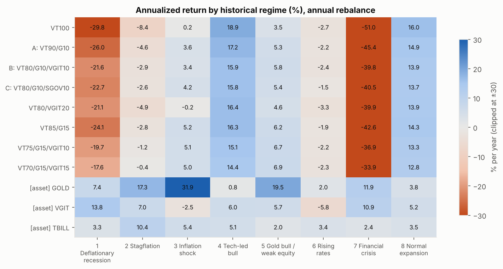

---

## 5. 리밸런싱 전략 비교

### 5.1 1972–2025 결과 (거래비용 5bp 반영)

| 정책 | A: CAGR | A: MDD | A: Sharpe | A: 누적 회전율 | A: 거래 leg 수 | B: CAGR | B: MDD | B: Sharpe | B: 회전율 | B: 거래 | B: 최종 $ |
|---|---|---|---|---|---|---|---|---|---|---|---|
| Buy & Hold | 9.23% | −49.9% | 0.377 | 0 | 0 | 9.05% | −46.5% | 0.381 | 0 | 0 | $8.62M |
| 연 1회 | 9.64% | −48.3% | 0.414 | 108% | 108 | 9.44% | −42.4% | 0.432 | 154% | 162 | $10.42M |
| 반기 | 9.59% | −48.6% | 0.410 | 138% | 216 | 9.38% | −43.0% | 0.427 | 201% | 324 | $10.13M |
| 분기 | 9.57% | −48.8% | 0.408 | 193% | 432 | 9.37% | −43.5% | 0.426 | 284% | 648 | $10.10M |
| 월 | 9.55% | −48.9% | 0.407 | 325% | 1296 | 9.32% | −43.7% | 0.421 | 460% | 1944 | $9.84M |
| **연 1회 점검 + 5pp 밴드** | **9.92%** | **−47.3%** | **0.429** | **80%** | **20** | **9.69%** | **−41.9%** | **0.446** | 116% | **45** | **$11.80M** |
| 5pp 절대 threshold(매월 점검) | 9.72% | −48.0% | 0.417 | 77% | 28 | 9.50% | −43.1% | 0.432 | 116% | 63 | $10.73M |
| 25% 상대 threshold(매월 점검) | 9.64% | −48.5% | 0.413 | 124% | 84 | 9.42% | −43.1% | 0.427 | 156% | 129 | $10.31M |

- 회전율은 one-way 누적 기준입니다(0.5 × Σ|Δw|). 거래 leg는 리밸런싱 1회당 실제로 사고판 ETF 수의 합입니다.
- 54년간 거래비용 총액은 연 1회 기준으로 회전율 1.5 × 5bp ≈ 포트폴리오의 0.08% 수준이라 **무시할 만합니다.**
- **2009–2025(ETF 시대)에서는 정책 간 차이가 ±10bp 이내**였습니다. B는 오히려 buy-and-hold가 가장 높았습니다(10.63% vs 연 1회 10.45%). 주식이 한 방향으로 계속 오른 구간이었기 때문입니다.

### 5.2 진짜 리밸런싱 이득인가, 표본 효과인가?

- **이론적 diversification return** ≈ ½(Σwᵢσᵢ² − σₚ²)는 A 0.32%, B 0.41%, C 0.40%, VT70/G15/IT15 0.56%(연)입니다. 하지만 이는 "자산 간 기대수익이 같고 추세가 없다"는 전제의 상한값입니다.
- **30년 경로 block-bootstrap(2,000회)으로 본 리밸런싱 프리미엄(vs buy & hold)** — `rebalancing_premium_bootstrap.csv`

| 포트폴리오 | 정책 | 평균 | 중앙값 | 5%–95% | P(>0) |
|---|---|---|---|---|---|
| A | 연 1회 | −19bp | +11bp | −179 ~ +48bp | 60% |
| A | 연 1회 + 5pp 밴드 | −12bp | +14bp | −167 ~ +62bp | 63% |
| B | 연 1회 + 5pp 밴드 | −14bp | +11bp | −162 ~ +64bp | 61% |
| C | 연 1회 + 5pp 밴드 | −24bp | +1bp | −171 ~ +55bp | 51% |

- **결론**: 분포가 **음의 왜도**를 보입니다. 대부분의 경로에서는 소폭 이득을 보지만, 주식이 장기 추세로 오르는 경로에서는 크게 손해를 봅니다(고수익 자산을 계속 덜어내기 때문).
  1972–2025의 +40~70bp는 **금의 1980 고점 → 2001 저점이라는 표본 특유의 평균회귀** 덕이 큽니다. 리밸런싱 수익 프리미엄은 **통계적으로 신뢰할 수 없습니다.**
- 리밸런싱의 확실한 효과는 **위험 프로파일 유지**입니다. B의 MDD는 buy & hold −46.5%에서 연 1회 −42.4%로 줄었고, 리밸런싱하지 않으면 시간이 지나며 주식 비중이 90%를 넘게 표류합니다.
- **스트레스 회복 시뮬레이션**(§9)에서도 같은 결과입니다. 주식 급락 뒤 V자·완만·L자 회복 모두에서 연 1회 리밸런싱이 무리밸런싱보다 +$300~3,500 높았습니다. 반면 금 약세장 시나리오에서는 손실(−$500~4,300)이 났습니다.
  매월 점검하는 5pp threshold는 **하락이 진행되는 도중에 주식을 사들여** 연 1회보다 대체로 −$20~1,500 불리했습니다.

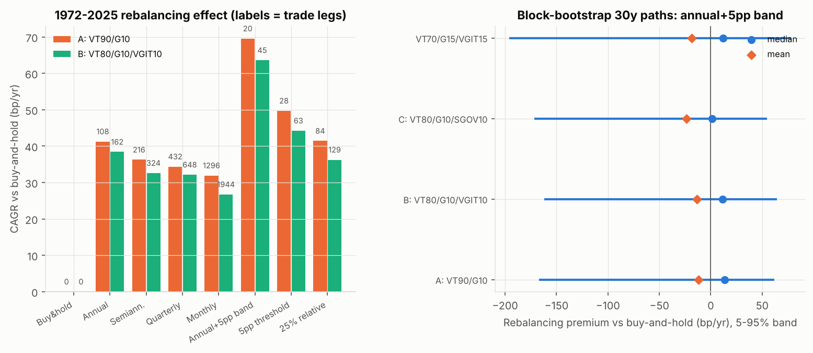

---

## 6. 포트폴리오 최적화

탐색 공간은 VT 60–100%, 금 0–30%, VGIT 0–30%, T-bill 0–30%(합 100%), **2.5% 간격 그리드 909개**이며 연 1회 리밸런싱입니다. 이산 그리드에서는 전수탐색이 전역최적을 보장하므로 `scipy.optimize`를 쓰지 않았습니다.

### 6.1 목적함수별 in-sample 최적 비중 (`optimization_by_window.csv`)

| 목적 | 1972–2025 | 1972–2024 (ex-2025) | 1980–2024 | 2000–2025 | 2009–2025 | 2009–2024 |
|---|---|---|---|---|---|---|
| A: max CAGR | VT70/G30 (10.06%) | VT70/G30 (9.64%) | VT100 | VT70/G30 | VT98/G2 | VT100 |
| B1: max Sharpe | VT60/G22/IT18 (0.489) | VT60/G20/IT20 | VT60/IT30/TB10 | VT60/G30/IT10 | VT60/G30/IT10 | VT60/G30/IT10 |
| B2: max Sortino | VT60/G30/IT10 | VT60/G25/IT15 | VT60/IT30/TB10 | VT60/G30/IT10 | VT60/G30/IT10 | VT60/G30/IT10 |
| C: MDD ≤20% | **불가능** | **불가능** | **불가능** | **불가능** | VT68/G30/TB2 | VT68/G30/TB2 |
| C: MDD ≤25% | **불가능** | **불가능** | **불가능** | **불가능** | VT95/G5 | VT95/G5 |
| C: MDD ≤30% | VT60/G30/IT10 (9.79%) | VT60/G30/IT10 | VT60/G10/IT30 | VT60/G30/IT10 | VT98/G2 | VT100 |
| C: MDD ≤35% | VT68/G30/IT2 | VT68/G30/IT2 | VT68/G2/IT30 | VT68/G30/IT2 | VT98/G2 | VT100 |
| C: MDD ≤40% | VT70/G30 | VT70/G30 | VT75/IT25 | VT70/G30 | VT98/G2 | VT100 |
| D: min CVaR (CAGR ≥ max−0.5pp) | VT60/G25/IT15 | VT60/G22/IT18 | VT78/IT22 | VT60/G28/IT12 | VT68/G30/TB2 | VT82/G18 |
| D′: min CVaR (무제약) | VT60/IT28/TB12 | 동일 | VT60/IT30/TB10 | VT60/IT30/TB10 | VT60/IT10/TB30 | 동일 |

- **MDD ≤20% · ≤25%는 1972/1980/2000 시작 구간에서 불가능**합니다. 허용 범위 안의 최소 MDD가 −29.5%(VT ≥60% 하한 때문)입니다.
- **경계해(corner solution) 문제**: 거의 모든 목적에서 VT=60%(하한) 또는 금=30%(상한)에 붙습니다. 비중 상·하한이 실제 제약으로 작동했다는 뜻이며, 금의 표본 수익률(1972–2025 8.8%/년, 2000–2025 11.0%/년)이 과대 반영된 결과입니다.

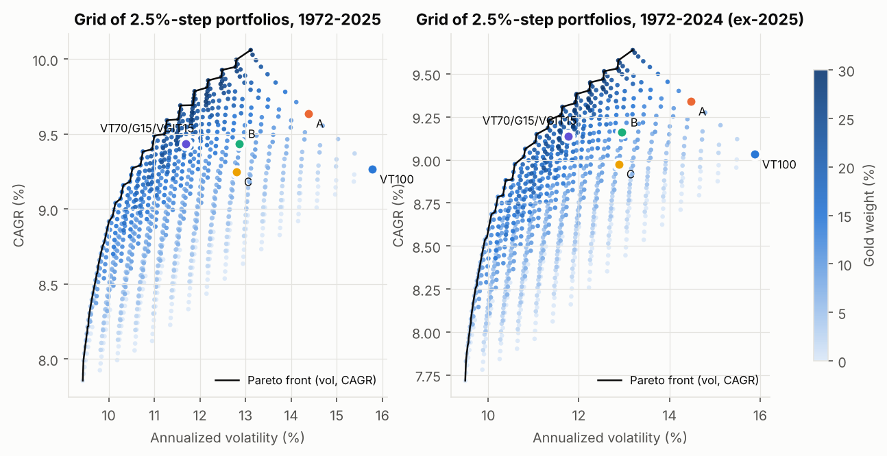
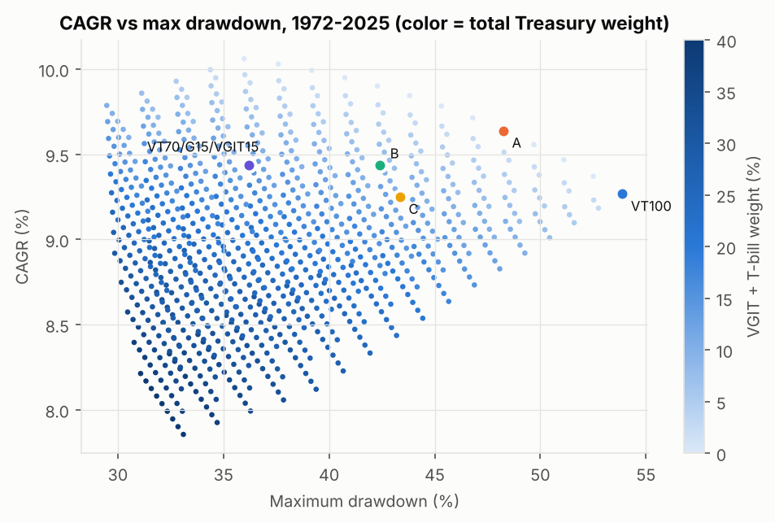

### 6.2 최적 비중의 불확실성 (block-bootstrap 재표본 500회 × 재최적화)

| 목적 | 금 비중 중앙값 [10%, 90%] | VGIT 중앙값 [10%, 90%] | VT 중앙값 [10%, 90%] |
|---|---|---|---|
| max Sharpe | 20% [5, 30] | 19% [10, 30] | 60% [60, 60] |
| max CE(γ=3) | 27.5% [2.5, 30] | 10% [0, 30] | 60% [60, 77.5] |
| max CAGR \| MDD≤35% | 30% [2.5, 30] | 2.5% [0, 25] | 70% [60, 82.5] |
| max CAGR | 30% [0, 30] | 0% [0, 10] | 70% [60, 100] |

→ 금 비중의 80% 신뢰구간이 **0~30% 전 범위**에 걸칩니다. "최적 금 비중"은 데이터로 정밀하게 식별되지 않습니다.

### 6.3 Walk-forward Out-of-Sample (1990–2025)

매년 1월에 직전까지의 데이터만으로 비중을 고르고, 그 비중을 1년간 유지했습니다(expanding window, 20년 rolling window 각각).

| 전략 | CAGR | 변동성 | MDD | Sharpe | CE(γ=3) | 최종 $ (1990 $80k) |
|---|---|---|---|---|---|---|
| WF max Sharpe | 7.35% | 9.7% | −29.7% | 0.505 | 6.33% | $1.03M |
| WF max CE3 | 7.52% | 10.0% | −29.8% | 0.508 | 6.42% | $1.09M |
| WF max CAGR \| MDD≤35% | 7.83% | 12.0% | −36.1% | 0.465 | 6.22% | $1.21M |
| WF max Sharpe (rolling 20y) | 7.60% | 9.5% | −31.1% | **0.539** | **6.62%** | $1.12M |
| 고정 VT100 | 8.09% | 15.3% | −53.9% | 0.412 | 5.47% | $1.32M |
| **고정 A (VT90/G10)** | **8.14%** | 13.9% | −48.3% | 0.441 | 5.97% | **$1.34M** |
| 고정 B (VT80/G10/VGIT10) | 7.94% | 12.3% | −42.4% | 0.466 | 6.26% | $1.25M |
| 고정 C | 7.72% | 12.4% | −43.4% | 0.448 | 6.02% | $1.16M |
| 고정 VT60/VGIT40 | 7.16% | 9.0% | −30.1% | 0.517 | 6.28% | $0.97M |

- **재최적화가 성장 면에서 고정비중을 이기지 못했습니다.** 최적화 규칙들의 Sharpe가 높은 것은 주로 VT 60%(낮은 주식 비중) 때문이며, 같은 위험 수준의 고정 VT60/VGIT40과 비슷합니다.
- 비중이 크게 흔들렸습니다. 금 30%(1990) → 12%(1999–2003) → 30%(2008–) 식으로, 직전 금 성과를 추종했습니다(그림 12).

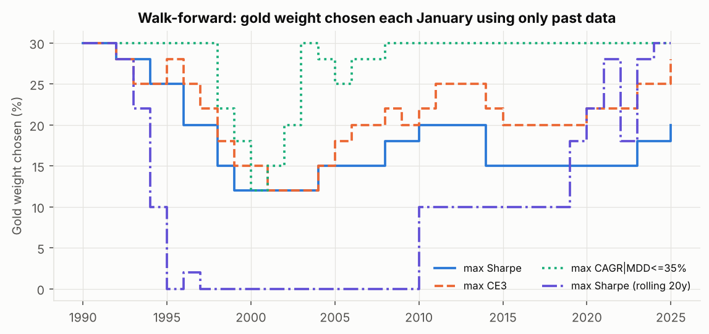

### 6.4 Optimization E: Robust 배분

1. **순수 이력 기반 robust 목적**: 14개 구간(2025 포함/제외)과 8개 국면에서 CE(γ=3) minimax-regret과 평균 regret을 합성하고, ETF 3개째부터 개당 0.05%/년 복잡도 페널티를 적용했습니다. 결과는 **VT60/G30/IT10**으로, 역시 경계해입니다.
   2-ETF 중 최선은 VT70/G30입니다. 이 결과는 2000년 이후 모든 구간에 금 강세장이 들어 있어 금에 유리하게 편향되어 있으므로 **그대로 채택하지 않았습니다.**
2. **통합 스코어카드**(`scorecard_summary.csv`): 이력 14개 구간 + 4개 Monte Carlo 방법(forward 가정 포함) + 8개 국면을 함께 봤습니다.

| 후보 | 이력 CAGR 중앙값 | 최소 CAGR | 최악 MDD | MC 중앙값: 최악방법 비율 | MC P5: 평균 비율 | MC P(MDD>40%) 평균 | 최악 국면 수익 | ETF 수 |
|---|---|---|---|---|---|---|---|---|
| VT100 | 9.9% | 6.1% | −53.9% | 0.864 | 0.640 | 68% | −51.0% | 1 |
| A: VT90/G10 | 9.6% | 6.7% | −48.3% | 0.938 | 0.771 | 53% | −45.4% | 2 |
| VT85/G15 | 9.8% | 6.9% | −45.3% | **0.953** | 0.829 | 46% | −42.6% | 2 |
| B: VT80/G10/VGIT10 | 9.4% | 6.6% | −42.4% | 0.888 | 0.861 | 37% | −39.8% | 3 |
| C: VT80/G10/SGOV10 | 9.2% | 6.4% | −43.4% | 0.842 | 0.822 | 39% | −40.5% | 3 |
| **VT75/G15/VGIT10** | 9.3% | 6.8% | −39.3% | 0.912 | 0.921 | 25% | −36.9% | 3 |
| **VT70/G15/VGIT15** | 9.0% | 6.7% | −36.2% | 0.881 | **0.961** | **15%** | −33.9% | 3 |
| VT80/G10/VGIT5/SGOV5 | 9.3% | 6.5% | −42.9% | 0.865 | 0.843 | 37% | −40.1% | 4 |
| VT60/G30/VGIT10 | 9.4% | 7.1% | −29.5% | 0.858 | 0.960 | 10% | −27.9% | 3 |

"MC 중앙값: 최악방법 비율"은 4개 MC 방법 각각에서 (해당 후보 중앙값 / 그 방법의 최고 중앙값)을 구한 뒤 그중 최솟값입니다.

→ **VT75/G15/VGIT10**은 B를 거의 모든 열에서 지배합니다. 성장(최악방법 0.912)과 꼬리(P5 0.921, P(MDD>40%) 25%)의 균형이 가장 좋습니다.
VT60/G30/IT10은 꼬리는 최상이지만, 보수적 forward 가정(parametric)에서 중앙값이 가장 낮고($395k) 2026 OOS도 최하위(+6.3%)여서 금 가정에 대한 의존도가 너무 큽니다.

---

## 7. 금 비중 민감도와 2025 효과

**손익분기 금 수익률**: VT 대비 X% 금을 섞었을 때 이득이 0이 되는 금의 연 CAGR입니다(금 로그수익률을 상수만큼 낮추며 이분탐색). `gold_breakeven.csv`

| 금 비중 | 구간 | 실제 금 CAGR | CAGR 기준 손익분기 | **Sharpe 기준 손익분기** |
|---|---|---|---|---|
| 10% | 1972–2025 | 8.8% | 5.2% | **2.2%** |
| 10% | 2000–2025 | 11.0% | 4.8% | **1.7%** |
| 10% | 1980–2024 | 3.8% | 7.6% | **4.1%** |
| 15% | 1972–2025 | 8.8% | 5.5% | 2.6% |
| 20% | 1972–2025 | 8.8% | 5.7% | 3.1% |
| 20% | 1980–2024 | 3.8% | 7.9% | 4.8% |

→ 금 10–15%는 **금이 장기적으로 인플레이션 수준(≈2.5–4%)만 내도 Sharpe를 개선**합니다. **CAGR까지 올리려면 금이 ~5–8%/년**을 내야 하며, 이는 역사적으로 1980–2024에는 달성하지 못한 수준입니다.

**2025의 영향**(GLDM +64.2%, VT +22.4%, VGIT +7.3%):
- 장기(1972–) 최적해는 거의 그대로입니다. max-Sharpe는 VT60/G22/IT18에서 VT60/G20/IT20으로, max-CAGR은 VT70/G30 그대로입니다.
- 2000–2025 금 CAGR은 11.0%인데 2025를 빼면 9.3%입니다. A − VT100의 CAGR 우위는 2016–2025 +0.4pp에서 2016–2024 +0.1pp로 줄고, 2009–2024에서는 VT100이 앞섭니다(10.7% vs 10.4%).
- 금 비중 곡선(그림 11)을 보면 2025를 빼도 Sharpe 최대점은 대부분의 장기 구간에서 금 15–25%에 있습니다. CAGR 최대점은 구간에 따라 0%(1980–, 2009–)와 30%(1972–, 2000–)로 나뉩니다.

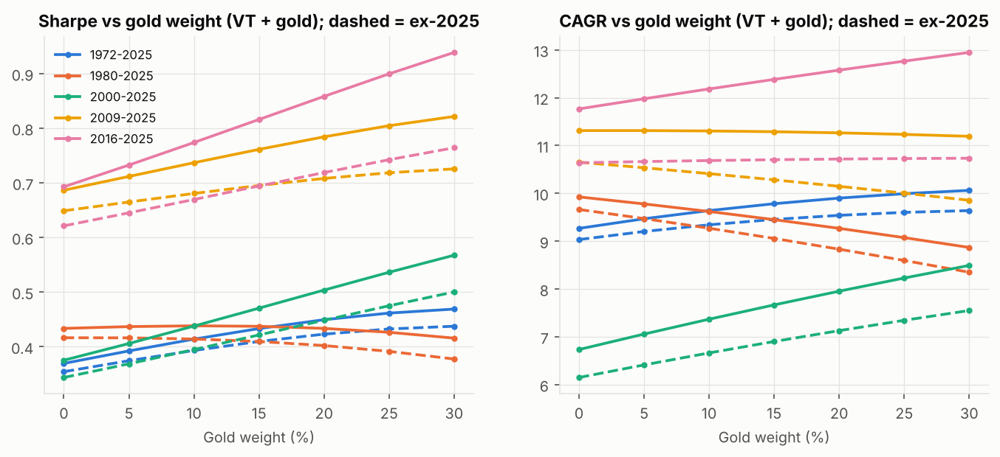

---

## 8. Monte Carlo (30년, 2026→2055, 10,000 경로, 연 1회 리밸런싱, 5bp 비용)

**네 가지 방법** — 모든 확률은 **모델 추정치**이며 경험적으로 관측된 빈도가 아닙니다.

1. **Historical block bootstrap**: 1972–2025 월간 결합수익률(5변수: 4자산 + CPI)에서 stationary bootstrap(평균 블록 24개월)으로 표본을 뽑아 계열·교차 의존성을 보존합니다. **역사적 금 8.8%/년이 그대로 들어가므로 낙관적**입니다.
2. **Forward-calibrated bootstrap (기본 케이스)**: 1과 같은 블록 구조에서 각 자산의 로그평균만 아래 forward 가정으로 이동시켰습니다(변동성, 상관, 꼬리 구조는 역사 그대로).
   VT 6.0%, 금 **3.0%**(장기 인플레이션+α, 고의로 보수적), VGIT 4.4%(현재 5년물 ≈4.65%에서 비용·변동 차감), T-bill 3.25%(현재 ≈4.0%에서 하락 가정), CPI 2.75%.
3. **Regime-switching**: 정상 / 고인플레이션(CPI YoY>5%) / 주식 스트레스(VT 고점 대비 −15% 이하) 3상태 Markov chain(역사 전이확률)을 쓰고, 각 상태에서는 해당 역사적 월을 재추출했습니다.
4. **Parametric multivariate-t(df=5) + 모수 불확실성**: 경로마다 기대수익을 N(forward, σ_μ)에서 새로 뽑고(σ_μ: VT 1.5%, 금 3%, VGIT 0.75%), 상관 국면은 50/50으로 뽑았습니다(주식–채권 −0.2 vs +0.35).

### 8.1 기본 케이스(②) 결과 — 명목 $, 실질은 2026$

| | VT100 | **A** | **B** | **C** | VT85/G15 | **VT75/G15/IT10** | **VT70/G15/IT15** |
|---|---|---|---|---|---|---|---|
| 중앙값 | $461k | **$468k** | $461k | $443k | $466k | $457k | $451k |
| P10 / P90 | $170k / $1,165k | $196k / $1,074k | $212k / $974k | $203k / $942k | $202k / $1,041k | $218k / $942k | **$225k** / $895k |
| P5 (하방) | $128k | $152k | $169k | $161k | $159k | $178k | **$186k** |
| 실질 중앙값 / 실질 P10 | $205k / $75k | $207k / $88k | $204k / $96k | $197k / $92k | $207k / $93k | $204k / $100k | $201k / **$103k** |
| P(≥$500k) 명목 | 45.5% | **46.0%** | 44.5% | 42.3% | 45.6% | 44.0% | 42.4% |
| P(≥$1M) 명목 | **14.4%** | 12.1% | 9.2% | 8.3% | 11.2% | 8.2% | 6.9% |
| P(≥$500k) 실질 | **11.4%** | 8.3% | 5.8% | 5.0% | 7.2% | 4.8% | 3.6% |
| P(MDD>30%) | 94.8% | 87.6% | 82.0% | 82.8% | 86.3% | 72.2% | **65.6%** |
| P(MDD>40%) | 79.3% | 65.5% | 48.8% | 55.0% | 60.7% | 41.6% | **16.9%** |
| E[MDD] | −50.1% | −44.5% | −39.2% | −39.7% | −42.0% | −36.6% | **−33.9%** |

### 8.2 방법별 중앙값 / P5 / P(MDD>40%)

| | ① 역사 bootstrap | ② forward bootstrap | ③ regime-switching | ④ parametric-t |
|---|---|---|---|---|
| VT100 | $1,145k / $319k / 75% | $461k / $128k / 79% | $1,169k / $187k / 64% | **$460k** / $93k / 54% |
| A VT90/G10 | $1,254k / $408k / 53% | **$468k** / $152k / 66% | $1,270k / $243k / 49% | $446k / $102k / 42% |
| B VT80/G10/IT10 | $1,180k / $434k / 38% | $461k / $169k / 49% | $1,202k / $280k / 33% | $440k / $117k / 27% |
| C VT80/G10/TB10 | $1,120k / $407k / 40% | $443k / $161k / 55% | $1,140k / $265k / 35% | $425k / $114k / 27% |
| VT85/G15 | **$1,293k** / $446k / 44% | $466k / $159k / 61% | **$1,315k** / $275k / 42% | $438k / $106k / 37% |
| VT75/G15/IT10 | $1,213k / $473k / 11% | $457k / $178k / 42% | $1,235k / $313k / 26% | $429k / $120k / 22% |
| VT70/G15/IT15 | $1,171k / **$483k** / **6%** | $451k / **$186k** / **17%** | $1,193k / **$330k** / **19%** | $422k / **$127k** / **16%** |

- ①③의 중앙값 $1.1–1.3M(연 9.3–9.9%)은 1972–2025라는 **매우 우호적인 표본**을 재생한 결과입니다. 계획의 기준으로는 ②④(연 5.5–6%, 중앙값 ≈ $420–470k)를 권합니다.
- **보수적 가정(②④)에서 포트폴리오 간 중앙값 차이는 ±5% 이내**입니다. 차이는 하방(P5, MDD)에서 나며, **자산배분 선택은 사실상 꼬리위험의 선택**입니다.
- $1M 목표: ② 기준 7–14%, ④ 기준 12–22%(명목)입니다. 추가 납입 없이 $80k로 실질 $1M에 도달할 확률은 모든 보수적 시나리오에서 6% 미만입니다. **목표 달성의 지배 변수는 배분이 아니라 추가 납입입니다.**

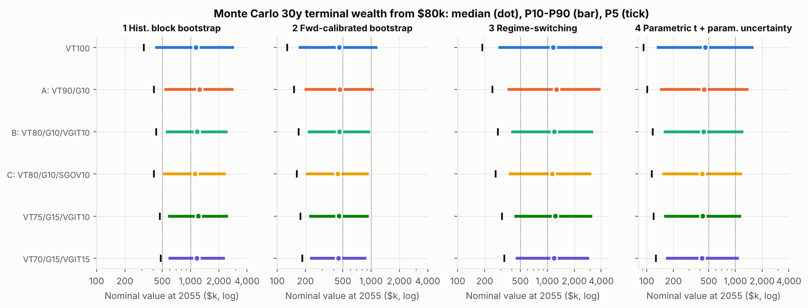
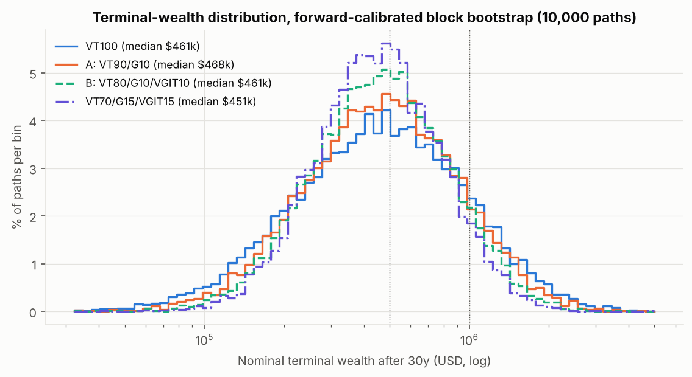

---

## 9. 스트레스 테스트 (가상 충격, 예측 아님)

### 9.1 즉시 손실과 잔여 자산 ($80,000 기준)

| 포트폴리오 | A 주식폭락 (−40/+15/+10/+4) | B 스태그플레이션 (−25/+20/−15/+4) | C 금 약세 (+15/−30/+3/+4) | D 주식·채권 동반하락 (−30/−10/−15/+4) |
|---|---|---|---|---|
| VT100 | −40.0% → $48,000 | −25.0% → $60,000 | +15.0% → $92,000 | −30.0% → $56,000 |
| A VT90/G10 | −34.5% → $52,400 | −20.5% → $63,600 | +10.5% → $88,400 | −28.0% → $57,600 |
| B VT80/G10/VGIT10 | −29.5% → $56,400 | −19.5% → $64,400 | +9.3% → $87,440 | −26.5% → $58,800 |
| C VT80/G10/SGOV10 | −30.1% → $55,920 | −17.6% → $65,920 | +9.4% → $87,520 | **−24.6% → $60,320** |
| VT75/G15/VGIT10 | −26.8% → $58,600 | −17.3% → $66,200 | +7.0% → $85,640 | −25.5% → $59,600 |
| VT70/G15/VGIT15 | **−24.3% → $60,600** | −16.8% → $66,600 | +6.5% → $85,160 | −24.8% → $60,200 |

### 9.2 목표비중 복원에 필요한 거래 (+매수 / −매도)

| 시나리오 | 포트폴리오 | VT | GLDM | VGIT | SGOV |
|---|---|---|---|---|---|
| A 주식폭락 | A | +$3,960 | −$3,960 | | |
| | B | +$6,720 | −$3,560 | −$3,160 | |
| | VT75/G15/IT10 | +$7,950 | −$5,010 | −$2,940 | |
| | VT70/G15/IT15 | +$8,820 | −$4,710 | −$4,110 | |
| B 스태그플레이션 | A | +$3,240 | −$3,240 | | |
| | B | +$3,520 | −$3,160 | −$360 | |
| | VT75/G15/IT10 | +$4,650 | −$4,470 | −$180 | |
| C 금 약세 | A | −$3,240 | +$3,240 | | |
| | VT75/G15/IT10 | −$4,770 | +$4,446 | +$324 | |
| D 동반하락 | A | +$1,440 | −$1,440 | | |
| | B | +$2,240 | −$1,320 | −$920 | |
| | C | +$3,456 | −$1,168 | | −$2,288 |
| | VT75/G15/IT10 | +$2,700 | −$1,860 | −$840 | |

### 9.3 회복 경로별 리밸런싱 효과 (충격 6개월 + 회복 5년, 12개 포트폴리오 평균)

| 시나리오 | 회복 경로 | 연 1회 − 무리밸런싱 | 매월 5pp threshold − 연 1회 |
|---|---|---|---|
| A 주식폭락 | V자 / 완만 / L자 | +$3,482 / +$1,068 / +$931 | −$1,478 / −$1,156 / −$1,302 |
| B 스태그플레이션 | V자 / 완만 / L자 | +$1,852 / +$717 / +$669 | −$394 / −$350 / −$422 |
| C 금 약세 | V자 / 완만 / L자 | −$4,268 / −$1,009 / −$505 | +$572 / +$255 / −$21 |
| D 동반하락 | V자 / 완만 / L자 | +$669 / +$325 / +$391 | −$475 / −$205 / −$19 |

→ 연 1회 리밸런싱은 하락 자산이 회복하는 경로에서 유리합니다. 매월 threshold는 **하락 도중 조기 매수**로 대체로 불리합니다(−$20~1,500).
가정상 충격이 7–12월에 걸쳐 일어나고 연 1회 리밸런싱이 12월 말에 실행되므로, 이 결과는 **타이밍에 의존**합니다.

---

## 10. 최종 의사결정 Q&A

**Q1. VT90/금10은 이미 효율적인가, 국채 추가가 의미 있게 개선하는가?**
성장 기준으로는 거의 효율적입니다. 1972–2025와 2000–2025에서 VT100 대비 CAGR과 Sharpe가 모두 높았고, MC ①②③에서도 중앙값이 VT100 이상이었습니다.
국채(VGIT 10%)는 Sharpe를 통계적으로 유의하게 올립니다(+0.018, P=99%). 그러나 CAGR은 −0.2pp/년이며, **개선은 꼬리위험에 집중**됩니다(MDD −48%→−42%, P(MDD>40%) −15~−17pp).
"의미 있는가"는 사용자의 효용함수에 달려 있습니다. 목표에 "severe downside 통제"가 명시되어 있으므로 **의미 있다**고 판단합니다.

**Q2. VGIT vs SGOV?**
**VGIT가 우위**입니다. 장기 CAGR은 +0.19~0.24pp/년(P≥98%), Sharpe +0.012~0.016이었습니다. VGIT는 디플레이션 침체(+13.8%/년)와 금융위기(+10.9%)처럼 **금이 확실히 막아주지 못하는 국면**을 막습니다.
SGOV는 인플레이션·금리 상승 국면에서 낫지만, 그 국면은 금이 이미 커버합니다. 또 현재 수익률 곡선이 정상화되어 있어(5y ≈4.65% > 3M ≈4.0%) 기간 프리미엄이 양수입니다.
**두 가지를 함께 넣는 4-ETF 조합은 개선이 없어 기각**했습니다(스코어카드에서 B보다 열위).

**Q3. 가장 robust한 금 비중은?**
**10–15%**입니다. 근거는 다음과 같습니다.
(i) Sharpe 손익분기 금 수익률이 연 1.7–4.5%에 불과합니다.
(ii) 보수적 forward(금 3%) MC에서 10–15%는 중앙값을 VT100 대비 −5~+2% 범위로 유지하면서 P5를 +10~24% 개선합니다.
(iii) 20% 이상은 CAGR 손익분기가 5.7–7.9%로, 1980–2024 실적(3.8%)을 넘어서야 정당화됩니다.
(iv) bootstrap 재최적화에서 금 비중은 식별되지 않았습니다(0–30%).
국채가 없으면 10%, VGIT와 함께라면 15%를 권합니다(VGIT가 디플레이션 꼬리를 맡으므로 금은 인플레이션 꼬리를 조금 더 맡을 수 있음).

**Q4. 리밸런싱의 이득은 통계적으로 신뢰할 만한가?**
**수익 측면에서는 아닙니다.** bootstrap 평균은 음수이고 P(>0)은 51–65%입니다. 역사적 +40~70bp는 금의 1980→2001 평균회귀라는 표본 특유의 현상입니다.
**위험 측면에서는 그렇습니다**(목표 위험 수준 유지, MDD 감소). 연 1회 점검 + 5pp 밴드가 거래 수, 성과, 관리 부담 모두에서 최선이었습니다.

**Q5. 2025 금 랠리를 제외하면 최적 배분이 바뀌는가?**
장기 구간에서는 **거의 바뀌지 않습니다**(max-Sharpe G22→G20, max-CAGR 불변). 단기 구간(2009–, 2016–)에서는 금 우위가 크게 줄거나 사라집니다.
다만 장기 구간의 금 선호 자체가 1970년대(일부 투자 불가)와 2000년대 금 강세장에 기대고 있으므로, 2025보다 **이 두 시대가 더 큰 표본 의존성**입니다.

**Q6. 34세, 장기 성장, 저빈도 모니터링에 최적인 배분은?**
**VT 75 / GLDM 15 / VGIT 10**, 연 1회 점검 + 5pp 밴드입니다. 4개 MC 방법에서 중앙값은 A 대비 −2~−4%이고, P5는 +16~29%, P(MDD>40%)는 66%에서 42%로(②), 42%에서 22%로(④) 줄어듭니다. 54년 백테스트 기준 거래는 2–3년에 한 번꼴입니다.
**최대 위험은 배분이 아니라 행동(패닉 매도)**입니다. MDD를 −48%에서 −39%로 낮추는 것은 그 위험을 줄이는 실질적 수단입니다.

**Q7. 3–4개 ETF의 복잡성은 정당한가?**
- **3개(VT+GLDM+VGIT)**: 하방 통제 목적이 있다면 정당합니다. 연 1회 밴드 점검이면 운용 부담이 VT+금과 사실상 같습니다.
- **4개(+SGOV)**: **정당하지 않습니다.** 스코어카드 모든 지표에서 3-ETF보다 열위입니다.
- **오직 중앙값 성장만 중시한다면** 2-ETF A안이 더 단순하고 동등하거나 낫습니다. 이 경우 VGIT 추가를 권하지 않습니다.

**Q8. 미래 30년이 역사와 크게 다를 때 가장 robust한 배분은?**
**VT75/G15/VGIT10**입니다. 세 가지 거시 위험 축을 각각 다른 자산이 맡습니다. 성장은 VT, 디플레이션 붕괴는 VGIT, 인플레이션 붕괴는 금입니다.
8개 국면 중 어디에서도 최하위가 아니고(최악 국면 −36.9% vs A −45.4%), 최대 CAGR regret은 1.5pp입니다. 4개 MC 방법 모두에서 중앙값이 최고치의 91% 이상입니다.
가장 취약한 시나리오는 **"금 실질수익 음(−) + 주식 장기 강세"**입니다. parametric 기준으로 30년 중앙값이 A 대비 약 4%, VT100 대비 약 7% 뒤처집니다.

---

## 11. 최종 권고 3안

### ① Maximum Growth Portfolio — **VT 90% / GLDM 10%**
- **$80,000 배분**: VT $72,000 · GLDM $8,000
- **리밸런싱**: 매년 같은 날(예: 1월 첫 거래일) 1회 점검합니다. 금이 **5–15%** 밴드를 벗어났을 때만 10%로 복원합니다(VT 85–95%).
- **기대 trade-off**: 이력·MC 모두에서 중앙값 최상위권입니다(②에서 1위 $468k). 대신 MDD는 −48%(1972–2025)이고, P(MDD>40%)는 42–66%입니다.
- **실패 조건**: (1) 2000–02, 2008 같은 **디플레이션성 주식 붕괴**. 금의 위기 헤지는 불안정합니다(2020-02~03 금 −0.7%). (2) 금 실질 약세와 주식 장기 횡보가 겹치는 경우(1980–2000 유형). (3) −45% 이상 낙폭에서의 행동적 이탈.
- 대안으로 **VT85/G15**도 있습니다. 이력 기반 MC에서는 더 높지만, CAGR 손익분기 금 수익률이 5.5% 이상이어야 합니다.

### ② Maximum Risk-Adjusted Portfolio — **VT 70% / GLDM 15% / VGIT 15%**
- **$80,000 배분**: VT $56,000 · GLDM $12,000 · VGIT $12,000
- **리밸런싱**: 연 1회 점검, 5pp 밴드(VT 65–75, GLDM 10–20, VGIT 10–20)
- **기대 trade-off**: 중앙값은 A 대비 −4~−7%입니다. 대신 P5는 +18~36%, E[MDD]는 −34%(A −45%), P(MDD>40%)는 6–19%입니다. 1972–2025 MDD −36.2%, Sharpe 약 0.46입니다.
  in-sample max-Sharpe 해(VT60/G20–30/IT10–20)를 **의도적으로 할인**한 비중입니다(경계해, 과적합).
- **실패 조건**: (1) 2022형 **금리 급등 + 주식 하락**(VGIT와 VT 동반 하락). (2) 금 장기 약세(시나리오 C에서 +6.5%로 가장 적은 상승). (3) 1990년대·2010년대 같은 장기 주식 강세에서의 기회비용(기술주 강세 국면에서 VT100 대비 연 −4.5pp).

### ③ Robust Set-and-Forget Retirement Portfolio — **VT 75% / GLDM 15% / VGIT 10%** ← **주 권고**
- **$80,000 배분**: VT $60,000 · GLDM $12,000 · VGIT $8,000 (Robinhood 소수점 매수 사용, 매수 시 지정가 권장)
- **리밸런싱 규칙(전부)**:
  1. 1년에 한 번(생일, 1월 첫 거래일 등 고정일)만 확인합니다.
  2. VT가 70–80%, GLDM이 10–20%, VGIT가 5–15% 범위 안이면 **아무것도 하지 않습니다.**
  3. 하나라도 벗어나면 세 자산 모두 목표비중으로 복원합니다. IRA 내부라 세금은 없습니다.
  4. 그 외의 시점에는 시장을 보지 않습니다. 매월 threshold 점검은 이득이 없었습니다(§5, §9.3).
- **기대 trade-off**: 보수적 MC 중앙값은 ≈$430–457k(명목)로 A 대비 −2~−4%입니다. P5는 $120–178k로 A 대비 +16~29%, P(MDD>40%)는 22–42%로 A의 42–66% 대비 크게 낮습니다.
  이력 1972–2025 MDD는 −39.3%이고, 8개 국면 어디에서도 최하위가 아닙니다.
- **실패 조건**: (1) 금 실질수익 음(−)과 주식 장기 강세가 겹치는 경우(2026년 1–9월이 그 축소판: +8.8% vs VT +12.9%). (2) 인플레이션과 금리 상승이 장기화되며 금마저 부진한 1980–82형(VGIT 손실 + 금 −27%). (3) 달러 기반 자산 전반의 구조적 약세(모든 자산이 USD 표시).

### 공통 실행 메모
- 세 ETF 모두 Robinhood에서 수수료 없이 거래되고 소수점 거래가 가능합니다. 비용은 ER 가중 ≈0.06%/년(VT 0.06, GLDM 0.10, VGIT 0.03)입니다.
- 이 분석의 금액은 **세전**입니다. 인출 시 일반소득세가 부과됩니다. Roth 전환은 이 분석의 범위를 벗어납니다.
- 목표 금액에 대해서는 배분보다 **납입이 지배적**입니다. 연 $7,000을 추가 납입하면 같은 가정에서 결과가 달라지므로 별도로 다시 계산해야 합니다(코드에서 `INIT`과 납입 로직을 추가해 재실행).

---

## 12. 재현 방법

```bash
cd portfolio/src
bash fetch_data.sh          # raw data -> ../data (requires network)
pip install numpy pandas matplotlib xlrd openpyxl
python3 data.py             # builds panel + proxy validation printout
python3 analysis.py         # all tables -> ../output/tables, ../output/results.json (~1.5 min)
python3 figures.py          # figures -> ../output/figures + scorecard
```

| 파일 | 역할 |
|---|---|
| `src/data.py` | 원자료 파싱, 프록시→ETF 스플라이스, 비용 처리, 금 평균화 보정, CPI 보간, 검증 |
| `src/engine.py` | 벡터화 백테스트(8개 리밸런싱 정책, 거래비용), 지표, 그리드, stationary bootstrap |
| `src/analysis.py` | 구간 백테스트, 상관, 국면, 리밸런싱, 최적화, bootstrap 비중 안정성, walk-forward, 금 손익분기, 쌍별 검정, Monte Carlo, 스트레스, 2026 OOS |
| `src/figures.py` | 그림 12종 + 통합 스코어카드 |
| `output/tables/*.csv` | 모든 수치 결과 원본 |

난수 시드는 `SEED = 20261106`(고정)입니다. 그리드는 2.5% 간격이며, 1% 간격 등으로 바꾸려면 `E.weight_grid(step)`를 수정합니다.

**검증 권장 사항**: (1) 금 1972–2004 구간을 LBMA PM fix 월말가로 교체(LBMA 라이선스 필요). (2) VT 프록시를 MSCI ACWI IMI Gross TR(USD)로 교체(MSCI 데이터 필요). (3) 거래비용을 1bp, 10bp로 바꿔 민감도 확인(`engine.TC_BPS`).
